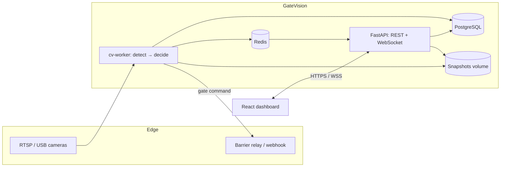

# GateVision — Smart Gate Management System

Real-time ANPR and face-recognition access control for residential compounds, with a
full management dashboard for security teams and residents.

GateVision watches the cameras at every entry/exit lane, reads the plate, recognises
the driver's face, evaluates the resident/visitor/blacklist rules in a fixed and
auditable order, and opens the barrier only when the vehicle or person is entitled to
enter. Every detection, decision, crop and override is stored and streamed to the
dashboard over WebSocket.

Built for Egypt and the Middle East: `Africa/Cairo` by default, Egyptian plate
normalisation (Latin + Arabic-Indic digits), Arabic-friendly data model, and
operations that work on a single box or in Docker Compose.

---

## Highlights

**Vision & access control**

- YOLOv8/v10 plate detection → OCR (EasyOCR **or** PaddleOCR, swappable) → normalised
  plate with confidence and crop.
- InsightFace face detection + 512-d embeddings with cosine-similarity gallery
  (enrollment, quality gates, hot reload).
- Combined plate + face decision engine: `allow` / `deny` / `unknown` / `review`,
  each with a machine-readable reason code.
- Blacklist by plate, person or face, with expiry dates.
- Multi-camera entry/exit lanes, bidirectional direction inference, RTSP / USB /
  video-file / demo sources, reconnect and per-camera health.
- Barrier control: simulated relay, HTTP webhook, and a dashboard command endpoint.
- **Real mode is the default** (`CV_MODE=real`): detections only ever come from
  camera frames. `CV_MODE=mock` is opt-in for offline development/tests and for
  the scripted demo — the system never invents a detection in real mode.
- Production-ready barrier drivers: signed HTTP webhook (recommended), MQTT, GPIO
  and a simulator for testing; every command is journaled with latency and result.
- Go-live runbook: [docs/real-deployment.md](docs/real-deployment.md).

**Operations**

- Live gate monitor: WebSocket feed, pause/freeze, gate filter, per-event review,
  barrier open/close/hold, image analysis playground, manual-entry recording.
- Residents & vehicles registry (units, ownership, stickers, plate uniqueness).
- Visitors and time-boxed temporary permits (window, entry limit, plate binding,
  revoke with reason, resident self-service requests).
- Access logs with compound/gate/decision/direction/plate/date/override filters,
  CSV and Excel export, and officer override with audit trail.
- Analytics: today's entries/exits, decision mix, peak hours, per-gate performance,
  unknown vehicles, face match rate, occupancy and heatmap.
- Roles: **Admin**, **Security Officer**, **Resident** — enforced in the API, the
  WebSocket subscription and the UI.
- Dark/light UI, responsive layout, skeleton/empty/error states.
- Full English/Arabic interface: every screen, toast, dialog and demo scenario is
  translated, and switching the language flips the whole layout to RTL (logical
  `ps/pe/start/end` utilities, `dir` on `<html>`, locale-aware dates and numbers).

**Platform**

- FastAPI (100 % type-hinted), SQLAlchemy 2.0 async, Alembic, Pydantic v2, JWT + RBAC.
- PostgreSQL + Redis (event fan-out, cache) in Compose; SQLite and an in-process bus
  for zero-dependency local development.
- Structured logging with request ids, uniform error envelope, health/readiness.
- 13-table relational model, retention/expiry maintenance job, demo seed.
- React 18 + Vite + TypeScript + Tailwind + React Query + Recharts.
- Backend: 100+ automated tests. Frontend: unit, i18n/RTL and integration tests against a live API.

---

## Tech stack

| Layer | Technology |
| --- | --- |
| API | Python 3.11+, FastAPI 0.115, Uvicorn |
| Data | SQLAlchemy 2.0 (async), Alembic, PostgreSQL 16 (SQLite for local dev) |
| Cache / events | Redis 7 pub/sub, in-memory fallback |
| Validation | Pydantic v2 + pydantic-settings |
| Auth | JWT access/refresh, argon2id, role + compound scoping |
| Vision | Ultralytics YOLO, EasyOCR / PaddleOCR, InsightFace (onnxruntime), OpenCV |
| Tasks | Async maintenance loop + `python -m app.tasks` CLI |
| Frontend | React 18, Vite 5, TypeScript 5, Tailwind 3, React Router 6, React Query 5, Axios, Recharts 2 |
| Frontend tests | Vitest + Testing Library + jsdom (against the real API) |
| Deployment | Docker multi-stage images, Docker Compose, nginx reverse proxy |

---

## Architecture at a glance



Deep dives:

- [docs/architecture.md](docs/architecture.md) — layering, data model, RBAC, ops.
- [docs/api.md](docs/api.md) — every endpoint, filters, errors, WebSocket events.
- [docs/cv-pipeline.md](docs/cv-pipeline.md) — detectors, thresholds, decision matrix.

---

## Repository layout

```
.
├── backend/
│   ├── app/
│   │   ├── api/            routes, dependencies, middleware, error mapping
│   │   ├── core/           config, logging, security, events, cache, exceptions
│   │   ├── db/             async engine and session management
│   │   ├── models/         13 SQLAlchemy models
│   │   ├── schemas/        Pydantic request/response contracts
│   │   ├── services/       business logic (auth, registry, visitors, access…)
│   │   ├── cv/             detectors, recognizers, pipeline, decision engine,
│   │   │                   gate controller, workers, runner
│   │   ├── tasks/          retention / expiry jobs
│   │   ├── cli.py          seed, create-admin, expire-permits, check
│   │   └── main.py         app factory, lifespan, routers, static media
│   ├── alembic/            migration environment + initial schema
│   ├── tests/              pytest suite (65 tests)
│   ├── requirements*.txt   core / CV / dev / PaddleOCR splits
│   └── Dockerfile
├── frontend/
│   ├── src/
│   │   ├── components/     UI kit, layout, guards, icon set
│   │   ├── pages/          dashboard, live monitor, registry, visitors,
│   │   │                   access logs, security, settings, login
│   │   ├── services/       typed API client + endpoints
│   │   ├── hooks/          auth, theme, toast, WebSocket, debounce
│   │   ├── types/          domain + envelope types
│   │   ├── test/           Vitest integration smoke tests
│   │   └── App.tsx         routing
│   ├── Dockerfile, nginx.conf
│   └── index.html, vite.config.ts, tailwind.config.js
├── docs/                   architecture, API, CV pipeline
├── docker-compose.yml
├── .env.example
└── README.md
```

---

## Quick start (Docker)

```bash
git clone https://github.com/DevMagdi/Mantiq--SmartGate.git
cd Mantiq--SmartGate

cp .env.example .env          # optional: every value has a working default
docker compose up --build
```

| Service | URL |
| --- | --- |
| Dashboard | <http://localhost:8080> |
| API + Swagger | <http://localhost:8000/docs> |
| Health | <http://localhost:8000/api/v1/health> |

The API applies migrations (`alembic upgrade head`) and starts with **production
defaults**: `CV_MODE=real`, `SEED_DEMO_DATA=false` (only the bootstrap admin
account), no demo cameras. Add your cameras in **Settings → Cameras** (or via
`CAMERAS_JSON`) and put the plate model in `./backend/models/` — the worker image
installs the full CV stack (`INSTALL_CV=true`).

For the offline demo instead:

```bash
CV_MODE=mock SEED_DEMO_DATA=true docker compose up --build -d
```

That seeds the demo compound and two synthetic camera feeds; the dashboard shows a
yellow "mock mode" banner so nobody mistakes it for a live site.

**Demo accounts**

| Role | Email | Password |
| --- | --- | --- |
| Administrator | `admin@gatevision.app` | `Admin@12345` |
| Security officer | `officer@gatevision.app` | `Officer@12345` |
| Resident | `ahmed@gatevision.app` | `Resident@12345` |

> Change `SECRET_KEY` and all demo credentials before exposing an instance.

---

## Local development (no Docker)

**Backend**

```bash
cd backend
python3.11 -m venv ../.venv && source ../.venv/bin/activate
pip install -r requirements.txt -r requirements-dev.txt
cp .env.example .env                 # SQLite + AUTO_CREATE_TABLES + mock CV
uvicorn app.main:app --reload --port 8000
```

**Frontend**

```bash
cd frontend
npm install
cp .env.example .env                 # VITE_API_BASE_URL=/api/v1, proxy to :8000
npm run dev                          # http://localhost:5173
```

The Vite dev server proxies `/api` and `/media` to `http://127.0.0.1:8000`, including
the WebSocket upgrade, so the browser only ever talks to one origin.

**Useful CLI commands**

```bash
cd backend
python -m app.cli check              # config + database + engine summary
python -m app.cli seed               # (re)create the demo compound
python -m app.cli create-admin --email ops@example.com --password 'Str0ngPass1'
python -m app.cli expire-permits     # one-shot expiry sweep
python -m app.tasks --once           # retention: permits, visitors, media, logs
python -m app.tasks --loop --interval 600
```

---

## How a decision is made

Rules are evaluated in a fixed order; the first match wins and is stored with a
reason code:

1. **Blacklist** (plate / face / person) → deny, barrier stays closed.
2. **Exit gate** for a vehicle already inside or a checked-in visitor → allow.
3. **Registered vehicle**: suspended/inactive, owner inactive, or face/owner mismatch
   (→ *review*) are checked before the allow.
4. **Visitor permit**: window, remaining entries, revoked/expired states, visitor
   status; valid permit → allow.
5. **Face recognition**: known face with an unknown plate → *review*; known face on
   foot → allow (configurable per compound); unknown plate → *unknown*.
6. No usable signal → *unknown*.

Every outcome records the direction, method (`plate`/`face`/`combined`/`permit`/
`manual`), confidence, snapshots, barrier state and whether it needs a human. Officers
can override from the log or the live monitor; the override is audited separately.

Full matrix: [docs/cv-pipeline.md § Decision engine](docs/cv-pipeline.md#4-decision-engine).

---

## Configuration

All runtime configuration is environment-driven (`backend/app/core/config.py`).
The most important variables:

| Variable | Default | Purpose |
| --- | --- | --- |
| `DATABASE_URL` | `sqlite+aiosqlite:///…/gatevision.db` | PostgreSQL in Compose, SQLite locally |
| `REDIS_ENABLED` / `REDIS_URL` | `false` / `redis://localhost:6379/0` | Event fan-out + cache |
| `SECRET_KEY` | dev placeholder | JWT signing — **must** change |
| `ACCESS_TOKEN_EXPIRE_MINUTES` | 60 | Access token TTL |
| `AUTO_CREATE_TABLES` | `false` | Development convenience only |
| `SEED_DEMO_DATA` | `false` | Demo compound + accounts (opt in) |
| `CV_MODE` | `real` | `real` (production) or `mock` (dev/demo only) |
| `CV_ALLOW_DEMO_SOURCES` | `false` | permit synthetic feeds in real mode |
| `CV_RTSP_TRANSPORT` | `tcp` | `tcp` \| `udp` \| `auto` |
| `CAMERAS_JSON` | empty | bootstrap cameras from the environment |
| `CV_RUNNER_ENABLED` | `true` | In-process camera workers |
| `CV_PLATE_MODEL_PATH` | `models/plate_yolov8.pt` | YOLO weights |
| `CV_YOLO_IMAGE_SIZE` / `CV_YOLO_IOU` | 640 / 0.45 | Detector input + NMS |
| `CV_YOLO_DEVICE` / `CV_YOLO_HALF` | auto / `false` | `cpu`, `0`, `cuda:1`; FP16 on GPU |
| `CV_OCR_ENGINE` | `easyocr` | `easyocr` \| `paddleocr` |
| `CV_OCR_ALLOWLIST` | `true` | constrain OCR to plate characters |
| `CV_FACE_SIMILARITY_THRESHOLD` | 0.45 | Face match threshold |
| `CV_DEDUPE_SECONDS` | 8 | Duplicate suppression window |
| `BARRIER_DRIVER` | `simulator` | `simulator` \| `webhook` \| `mqtt` \| `gpio` |
| `BARRIER_WEBHOOK_URL` / `_SECRET` | empty | Controller URL + HMAC secret |
| `MEDIA_ROOT` / `MEDIA_URL` | `backend/media` / `/media` | Snapshots |
| `RETENTION_DAYS` | 365 | Detections + media retention |
| `RETENTION_ACCESS_LOG_DAYS` | 730 | Audit-trail retention (longer) |
| `RETENTION_BATCH_SIZE` / `_MAX_BATCHES` | 5000 / 200 | Batched deletes per cycle |
| `MAINTENANCE_ENABLED` | `true` | In-process retention loop |

See [.env.example](.env.example) for the complete list with comments.

---

## API & real-time

- REST under `/api/v1`; Swagger at `/docs`, ReDoc at `/redoc`.
- JWT bearer auth, refresh tokens, uniform error envelope, pagination
  (`page`, `page_size`, `sort_by`, `sort_dir`).
- WebSocket `GET /api/v1/ws/events?token=<jwt>` streams `detection.created`,
  `access.decision`, `access.override`, `gate.command`, `camera.status`,
  `gallery.updated` and `maintenance.completed`.
- CSV/XLSX export: `GET /api/v1/access-logs/export?format=csv|xlsx`.
- Image analysis: `POST /api/v1/cv/analyze` (multipart) runs the full pipeline on an
  uploaded frame and persists the result.

Full reference with examples: [docs/api.md](docs/api.md).

---

## Testing

```bash
# Backend — SQLite, mock CV, no external services required
cd backend
DATABASE_URL="sqlite+aiosqlite:////tmp/gatevision-test.db" \
  PYTHONPATH=. python -m pytest tests -q

# Frontend — requires the backend above running on :8000
cd frontend
npm run typecheck
npm test          # Vitest + Testing Library against the live API
npm run build
```

The backend suite covers health/auth, RBAC, registry CRUD, visitors/permits, CV
decisions and snapshots, access logs and exports, analytics, WebSocket streaming,
retention tasks and CV primitives. The frontend suite signs in through the real API
and renders every screen for each role, asserting that data, tabs and role-based
navigation behave.

---

## Operations

- **Migrations:** `alembic upgrade head` (run automatically by the API container);
  `alembic check` verifies models match the schema.
- **Retention:** permits/visitors expire, detections/snapshots older than
  `RETENTION_DAYS` and access logs older than `RETENTION_ACCESS_LOG_DAYS` are
  purged in batches (a backlog drains over several cycles instead of locking the
  table). `python -m app.tasks.maintenance --dry-run` previews a cleanup;
  `--once` is the cron entry point when you disable the in-process loop.
- **Health:** `GET /api/v1/health` (liveness), `/health/live` (alias) and
  `/health/ready` (DB/Redis + vision engine, barrier driver, maintenance state).
- **Metrics:** `GET /metrics` — Prometheus counters/histograms/gauges for HTTP,
  decisions, barrier commands, vision outcomes, enrollments and maintenance.
- **Logs:** structured text or JSON (`LOG_FORMAT`), request ids on every response;
  every barrier command logs driver, latency and outcome.
- **Backups:** PostgreSQL + the media volume are the only stateful components.
- **Scaling:** run several `api` replicas behind the nginx container; Redis fan-out
  keeps every WebSocket subscriber in sync. Scale `cv-worker` by camera count/GPU.

---

## Going to Production

The demo path (`CV_MODE=mock`, SQLite, seeded accounts) is not production. Use the
three runbooks below; they are written to be followed in order.

1. **[docs/deployment.md](docs/deployment.md)** — the checklist: secrets, TLS and
   reverse proxy, database migrations/backups, container hardening, health probes,
   Prometheus alerts, go-live smoke test and rollback plan. The API itself refuses
   to boot in production with a placeholder `SECRET_KEY`, `DEBUG=true` or a
   wildcard `CORS_ORIGINS`.
2. **[docs/rtsp-cameras.md](docs/rtsp-cameras.md)** — move `CV_MODE=mock` to
   `CV_MODE=real`: camera placement/encoding, model weights (including
   fine-tuning a plate model on Egyptian plates), per-compound thresholds,
   shadow mode, and the camera troubleshooting table.
3. **[docs/hardware.md](docs/hardware.md)** — connect the barrier: signed HTTP
   webhook, MQTT or GPIO relay, with verification snippets, retry semantics and
   driver health/command journal.

Then prepare the data:

- **[docs/face-enrollment.md](docs/face-enrollment.md)** — resident/vehicle
  registration, the enrollment quality gates (and how to read each rejection),
  gallery pruning and biometric erasure.
- Configure barricade policy per compound in **Settings → Gate policy** or
  `PATCH /api/v1/compounds/{id}/settings` (vision thresholds, access rules,
  barrier driver). Secrets are masked on read and round-trip safely.

Minimum production configuration:

```bash
ENVIRONMENT=production
DEBUG=false
SECRET_KEY=$(openssl rand -hex 32)      # 64 chars
DATABASE_URL=postgresql+asyncpg://…
REDIS_ENABLED=true
CORS_ORIGINS=["https://gates.example.com"]
TRUSTED_HOSTS=["gates.example.com"]
SEED_DEMO_DATA=false
CV_MODE=real
CV_RUNNER_ENABLED=false                 # run `python -m app.cv.runner` as cv-worker
BARRIER_DRIVER=webhook
BARRIER_WEBHOOK_URL=https://controller.lan/api/barrier
BARRIER_WEBHOOK_SECRET=…
LOG_FORMAT=json
```

Verify after deploy:

```bash
curl -s https://gates.example.com/api/v1/health/ready | jq '.status, .checks'
curl -s https://gates.example.com/api/v1/cv/status -H "Authorization: Bearer $TOKEN" | jq
curl -s https://gates.example.com/api/v1/cv/actuators -H "Authorization: Bearer $TOKEN" | jq
curl -s https://gates.example.com/metrics | grep gatevision_cv_engine_ready
```

---

## Security notes

- Replace `SECRET_KEY`; rotate it by invalidating all refresh tokens.
- Passwords are hashed with argon2id; login attempts are rate-limited.
- Every query is scoped to the caller's compound; residents can only read their own
  household, visitors and logs.
- Uploaded images are validated by content type and size (`MAX_UPLOAD_MB`).
- Face embeddings are biometric data: never returned by the API, deactivated rather
  than silently replaced, deletable for erasure requests.
- Blacklist hits always deny and never open the barrier.
- Barrier secrets (webhook HMAC, MQTT password) are masked (`********`) by the API
  and never written to logs; webhook commands carry a timestamp+body HMAC the
  controller must verify (see `docs/hardware.md`).
- Production startup validates the security posture (secret length/placeholder,
  wildcard CORS, DEBUG, unrestricted hosts) and refuses to run with fatal issues.

---

## Troubleshooting

| Symptom | Fix |
| --- | --- |
| `503 vision_unavailable` | Real models requested but not loaded; check `/cv/status.warnings` and `CV_*` paths. |
| No detections in mock mode | Check `CV_ENABLED`, `CV_DEMO_CAMERAS`, and that cameras are `online` in Settings. |
| WebSocket stays “connecting” | Token expired, or the reverse proxy is not forwarding `Upgrade` headers (see `frontend/nginx.conf`). |
| Seed says “skipped” | The demo compound already exists; use `python -m app.cli seed` for details or a fresh database. |
| Excel export empty | Filters matched no rows or exceeded `EXPORT_ROW_LIMIT`; widen the range. |
| Camera `error` status | RTSP unreachable/expired credentials; check `last_error` on the camera row. |
| Barrier command `accepted=false` | driver unreachable or signature rejected; open **Live monitor → Barrier actuator** or `GET /cv/actuators` for the exact error. |
| Enrolment rejected with `enrollment_rejected` | photo failed a quality gate; the response `details.issues` lists each problem with a hint. |
| `/metrics` 404 | reverse proxy not routing it; see `docs/deployment.md` §4. |

---

## Documentation

| Document | Contents |
| --- | --- |
| [docs/architecture.md](docs/architecture.md) | Processes, data model, request/detection flows, RBAC, ops |
| [docs/api.md](docs/api.md) | REST reference, filters, errors, WebSocket protocol |
| [docs/cv-pipeline.md](docs/cv-pipeline.md) | Detectors, thresholds, decision matrix, real-mode checklist |
| [docs/rtsp-cameras.md](docs/rtsp-cameras.md) | Connecting real RTSP cameras, plate models, tuning, go-live |
| [docs/face-enrollment.md](docs/face-enrollment.md) | Enrollment quality gates, gallery pruning, vehicle registration |
| [docs/hardware.md](docs/hardware.md) | Barrier drivers: webhook HMAC, MQTT, GPIO wiring and troubleshooting |
| [docs/deployment.md](docs/deployment.md) | Production checklist: secrets, probes, metrics, alerts, rollback |
| [docs/real-deployment.md](docs/real-deployment.md) | **Go-live runbook**: real cameras, models, barrier webhook, hardware, troubleshooting |
