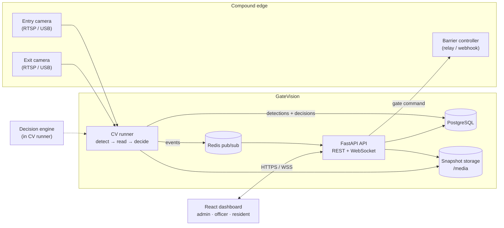
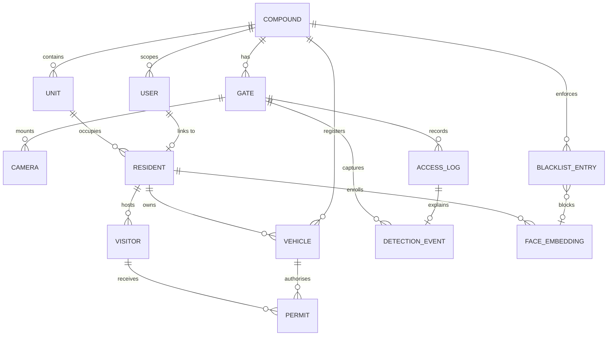
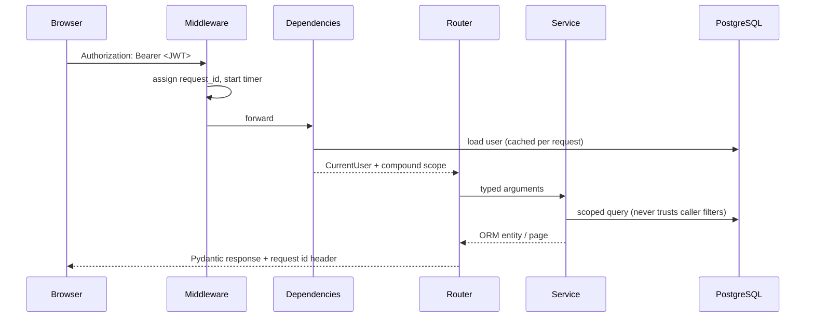
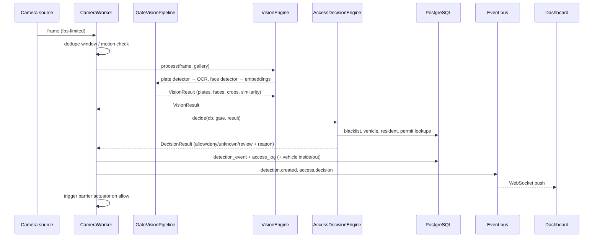

# GateVision Architecture

GateVision is a smart-gate management platform for residential compounds. It combines
number-plate recognition (ANPR), face recognition, a rules engine and a real-time
control dashboard so that a barrier opens only for people and vehicles that are allowed
to enter.

This document describes how the system is put together, why the boundaries are where
they are, and how the pieces behave under load and failure.

---

## 1. System context



The **API** and the **CV runner** are separate processes that share PostgreSQL,
Redis and the media volume. The API never loads machine-learning models when
`CV_RUNNER_ENABLED=false`; the worker never serves HTTP. This keeps the web tier
small and lets the vision tier scale (or be placed on a GPU host) independently.

---

## 2. Deployment topology

| Service | Image | Responsibility | Port |
| --- | --- | --- | --- |
| `postgres` | `postgres:16-alpine` | Durable system of record | 5432 (internal) |
| `redis` | `redis:7-alpine` | Event fan-out + cache | 6379 (internal) |
| `api` | `backend/Dockerfile` (`INSTALL_CV=false`) | REST, auth, exports, WebSocket, media | 8000 |
| `cv-worker` | `backend/Dockerfile` (`INSTALL_CV=true`) | Camera workers, detection, decision engine | – |
| `frontend` | `frontend/Dockerfile` | Static SPA + reverse proxy for `/api`, `/media`, `/ws` | 8080 |

`docker-compose.yml` starts PostgreSQL and Redis with health checks, runs
`alembic upgrade head` before the API starts, then boots the CV worker only once the
API is healthy. GateVision also runs on a single machine without Docker: SQLite +
in-process event bus + in-process camera manager (`CV_RUNNER_ENABLED=true`).

---

## 3. Backend layering

```
app/
├── api/                 HTTP layer — validation, auth dependencies, status codes
│   ├── deps.py          SessionDep, CurrentUser, ManagerUser, AdminUser, CompoundScope
│   ├── middleware.py    request id, timing, access logs, exception mapping
│   └── routes/          one module per resource; no business logic
├── core/                cross-cutting: config, logging, security, exceptions,
│                        events (in-memory + Redis bus), cache
├── db/                  async engine, session factory, session_scope()
├── models/              SQLAlchemy 2.0 mapped classes (13 tables)
├── schemas/             Pydantic v2 request/response models
├── services/            business rules, authorization scoping, persistence
├── cv/                  ALL computer vision and gate-control code
│   ├── detectors/       plate detector interface (YOLO + mock)
│   ├── recognizers/     OCR + face recognizer interfaces (EasyOCR/Paddle, InsightFace/mock)
│   ├── pipeline.py      frame → detections → crops → VisionResult
│   ├── gate_controller.py  decision engine + barrier actuators
│   ├── engine.py        process-wide VisionEngine singleton
│   ├── manager.py       camera lifecycle (DB → workers)
│   ├── worker.py        per-camera thread (fps limit, dedupe, status)
│   └── runner.py        standalone `python -m app.cv.runner`
└── tasks/               retention and expiry jobs (one-shot or loop)
```

**Rule:** routers own HTTP semantics only. They validate through Pydantic, resolve the
acting user through dependencies, call a service and serialise the result. Every
authorization decision (compound scope, ownership) lives in a service so it can be
tested without HTTP and reused by the CV runner.

---

## 4. Data model



Key modelling decisions:

* **Two audit tables.** `detection_events` stores raw model output (plate text,
  confidence, bounding boxes, crop URLs, embeddings used); `access_logs` stores the
  business decision, the reason code, the matched entities and whether the barrier
  opened. A manual override changes the log, never the raw detection.
* **Permits are time-boxed grants** with `start_at`, `end_at`, `max_entries` and
  `entries_used`, independent of the vehicle row so a plate can be re-used.
* **Face embeddings are biometric data.** The vector lives in a dedicated
  `TEXT`/JSON column, is excluded from API responses, and is deactivated (not
  silently deleted) so audit history remains valid.
* **Soft status enums instead of deletes** for residents, vehicles, users and
  cameras: the access history must survive staff turnover.
* **Unit labels** are derived (`{building}-{unit_number}`) and unique per compound.

---

## 5. Request lifecycle (HTTP)



* JWT access tokens are short-lived (60 min default); refresh tokens are long-lived
  and rotated by `POST /auth/refresh`.
* `argon2id` hashes passwords; login attempts are rate-limited per email.
* `CompoundScope` pins every non-admin query to the caller's compound. A security
  officer cannot read another compound even by guessing a UUID.
* Errors are uniform: `{"error": {"code", "message", "details", "request_id"}}`.

---

## 6. Detection and decision flow



Latency budget per frame (CPU, mock/real): frame grab ~5–15 ms, plate detection
20–60 ms depending on model, OCR 30–120 ms, face embed ~20–80 ms. The worker caps
FPS and deduplicates so a busy gate stays below one detection per second.

Full details are in [cv-pipeline.md](cv-pipeline.md).

---

## 7. Real-time events

The event bus has two implementations behind one interface:

* **In-memory** — default for local development and tests; zero dependencies.
* **Redis pub/sub** — used in Docker; the CV runner publishes and every API replica
  subscribes, so WebSocket clients connected to any replica receive the same stream.

| Event | Producer | Consumers |
| --- | --- | --- |
| `detection.created` | detection service | Live monitor feed, dashboards |
| `access.decision` | decision engine | Alerts, integrations |
| `access.override` | override endpoint | Audit widgets |
| `gate.command` | gate controller | Barrier audit |
| `camera.status` | camera manager | Camera health tiles |
| `gallery.updated` | face enrollment | CV workers (hot reload) |
| `maintenance.completed` | retention job | Operations dashboards |

Events carry only identifiers and small scalars; consumers re-query the API when they
need the full record. This keeps the pub/sub payload bounded.

---

## 8. RBAC

| Capability | Admin | Security officer | Resident |
| --- | :---: | :---: | :---: |
| View compound analytics | ✅ | ✅ | – |
| Live monitor + barrier control | ✅ | ✅ | – |
| Manual override / manual entry | ✅ | ✅ | – |
| Residents & vehicles CRUD | ✅ | ✅ | own household (read) |
| Visitors & permits | ✅ | ✅ | own unit only |
| Access logs | ✅ | ✅ | own records only |
| Blacklist & face gallery | ✅ | ✅ | – |
| Staff accounts, gates, cameras, compound profile | ✅ | gates/cameras (read+write), no staff | – |
| Export CSV/XLSX | ✅ | ✅ | – |

Enforcement happens in three places: FastAPI dependencies (`ManagerUser`, `AdminUser`),
service-level compound scoping, and WebSocket subscription scoping. The frontend hides
screens but is never the security boundary.

---

## 9. Operational concerns

* **Migrations.** Alembic with a single async environment; `alembic upgrade head` is
  part of the container command. `alembic check` verifies models match migrations.
* **Retention.** `python -m app.tasks --once` expires stale permits/visitors, purges
  detections/access logs older than `RETENTION_DAYS` (default 365) and prunes
  orphaned media files. The same job runs in-process every
  `MAINTENANCE_INTERVAL_SECONDS` (default 15 min) when `MAINTENANCE_ENABLED=true`.
* **Media volume.** Snapshots are written under `/data/media/{snapshots,plates,faces}`
  with date sharding (`YYYY/MM/DD`) so directories stay small. The API serves them
  read-only; nginx can be put in front for production.
* **Backups.** PostgreSQL is the only stateful store; media is content-addressed by
  timestamp and can be re-created from detections only if snapshots are also backed
  up. Back up both.
* **Observability.** Structured text or JSON logs with request ids; every response
  carries `X-Request-ID`; `/api/v1/health` (liveness) and `/api/v1/health/ready`
  (database + Redis) support orchestrators.
* **Secrets.** `SECRET_KEY`, database credentials and camera URLs come from the
  environment. Nothing is baked into images.

---

## 10. Extension points

* **Swap the plate detector** — implement `PlateDetector.detect()` in
  `app/cv/detectors/`, register it in the factory, set `CV_PLATE_DETECTOR`.
* **Swap OCR / face engine** — same recipe under `app/cv/recognizers/`.
* **New access rule** — add a reason code and a branch to `AccessDecisionEngine`;
  keep it pure (no I/O outside the session) so it stays unit-testable.
* **Alternative barrier hardware** — implement a `GateActuator` subclass or set
  `compound.settings.gate_webhook_url` to an HTTP endpoint.
* **Analytics** — services expose aggregate queries; add endpoints under
  `app/api/routes/analytics.py` without touching routers.
